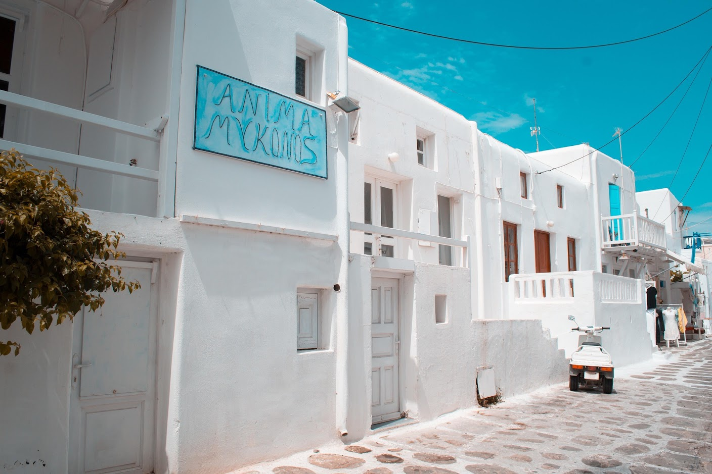
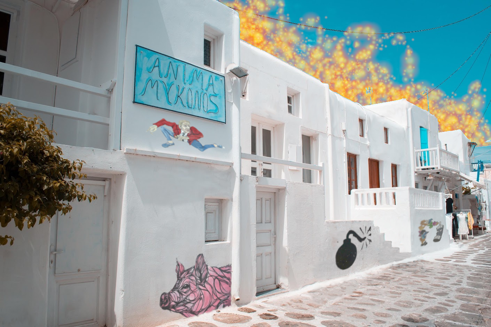

# Decorar Ciudad
En esta tarea tuvimos que editar una calle de una ciudad.

Usando las herramientas de clonado tuvimos que eliminar manchas, ventanas, objetos que no queramos y con la de perspectiva añadir unos grafities a las paredes de la calle, a estos grafities también les modificamos los valores de color como la saturación e intensidad.

Esta es la imagen proporcionada por el profesor:

Profesor-Usada para usos educativos, posibilidad de copiright.

### Producto Final
Yo he usado otra vez un pincel de orbes de luz en una capa inferior a los edificios. También eliminé la moto y unas cuantas manchas y un par de ventanas.

Así me quedó:

Modificada por (ARD)-Original con posibilidad de copiright.

