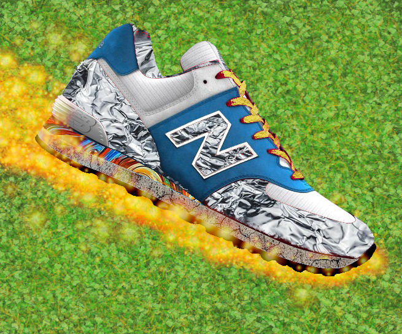

# Tuneado de zapatilla
Esta fue la primera tarea que hicimos con GIMP.

Y estas fueron las instrucciones del profesor en classroom:

Para realizar la práctica, es necesario que tu ordenador tenga instalada la aplicación GIMP.  Para empezar la tarea, debes descargate el archivo zapatilla.xcf y abrirlo con la aplicación.
La practica consiste en tunear una zapatilla, seleccionando zonas de color similar, y luego cambiando su color o modificando su textura.
El archivo ya dispone de algunas texturas para trabajar, pero tú puedes descargarte más desde la web PIXABAY. Para incorporarlas usa Archivo - Abrir como capas

Este es el archivo a descargar: [Descarga](https://drive.google.com/file/d/1HynA2o6lz-fsRSy6cCGa121pxEID6HnX/view)

## Proceso
En este trabajo usamos herramientas como la selección por color o la varita mágica para seleccionar una parte específica de la zapatilla y cambiarle el color.
También se utilizaron distintas texturas como de graffiti o papel de aluminio en distintas capas para sustituirlas por el área seleccionada de la zapatilla con las herramientas anteriores.

Yo también usé distintos pinceles para aportar un fondo vegetal y unas bolas de luz en la suela para dar sensación de flote.

La mía quedó así:

Propia(ARD)-Dominio Público

